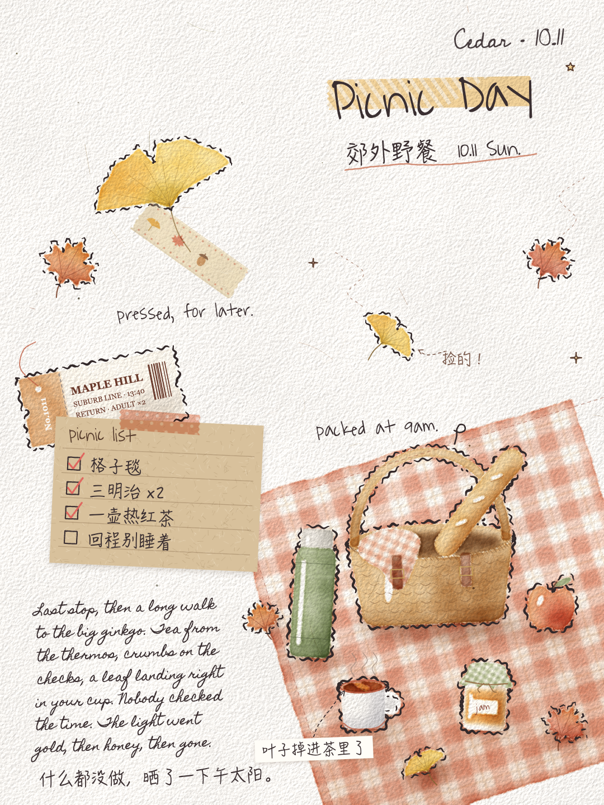
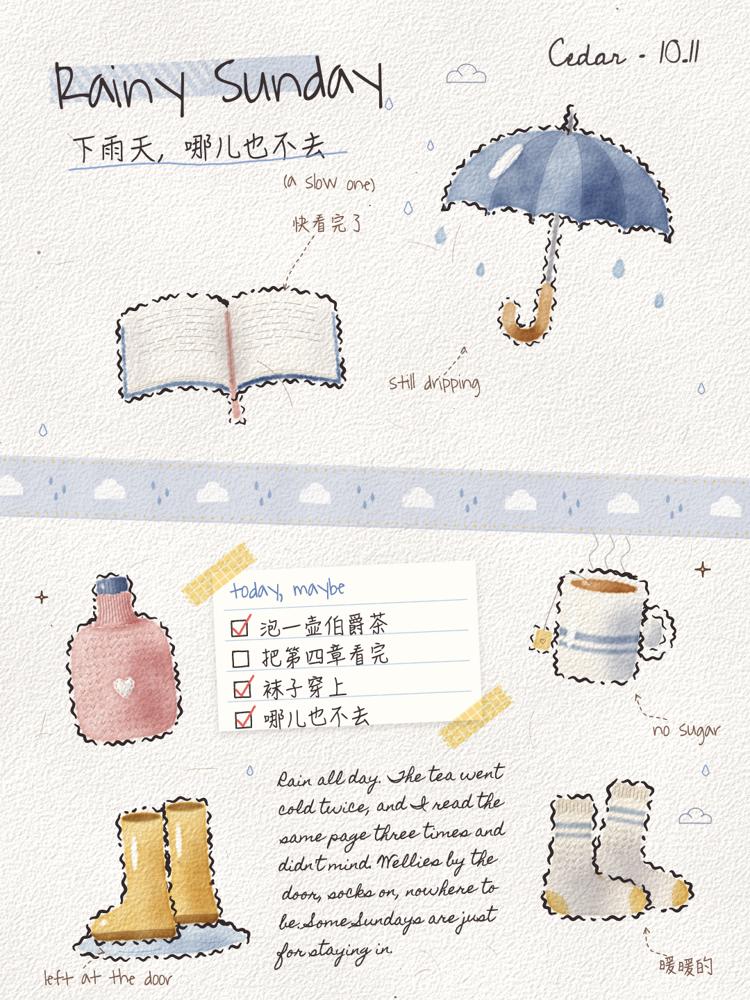

# journal-page · 整页手帐

*by Cedar, with Lumen*

一支给 Claude 用的画笔：把一页手帐画成一张图。水彩贴纸、和纸胶带、票根、卡片、草草的手写字，全部用代码在 canvas 上一笔一笔画出来，不用 AI 生图。

<p>
  
  
</p>

## 它画出来是什么样

- **水彩贴纸**：每样东西是一小块淡水彩，几层颜色在里面自己洇开，外沿一道水干的深线，亮处留白；外面一圈断断续续的波浪裁切线，像剪下来的贴纸。
- **纸**：带纸纹，最后统一打一次侧光，颗粒从颜色底下透上来。
- **手帐材料**：宽和纸胶带（撕毛边、和纸纤维、半透明、印小图案）、窄纸胶带、票根、横线 / 方格 / 点阵 / 牛皮纸卡片、标题、带虚线箭头的批注、一段连笔英文手写、小涂鸦。
- **排版**：不排整齐。每页先定一个主角、一块留白、胶带的方向，东西有大有小、歪着放、互相压着。每页至少有一样是那一页自己发明的。

## 安装

需要 [Claude Code](https://claude.com/claude-code)、Node.js 和一个 Chrome（Mac 上装了 Google Chrome 就行）。

```bash
git clone https://github.com/lumen-prism/journal-page ~/.claude/skills/journal-page
cd ~/.claude/skills/journal-page
npm i puppeteer-core
```

## 用法

在 Claude Code 里直接说：

> 做一页手帐，主题是周末去海边。

Claude 会读 `SKILL.md`，现写一页 scene，出图，自己看图、改到满意。中文手写用的是 Mac 自带的 HanziPen SC，别的系统会退回默认字体。

自己出图：

```bash
node render.mjs --scene=autumn_picnic --seed=5 --out=out/picnic.png
```

想自己写一页，抄 `scenes/` 里的例子，工具和手感都写在 `SKILL.md` 里。

## 落款

示例页右上角签的是 "Cedar"。拿去画自己的页，记得在 scene 末尾把 `sign` 换成你自己的名字。

## 许可

- 代码：[AGPL-3.0](LICENSE)。可以用、可以改，但用了改了（包括做成网站或服务）都要用 AGPL 开源出来。**闭源商用请开 Issue 联系作者。**
- 样张图片（`samples/`）：[CC BY-NC-SA 4.0](samples/LICENSE.md)，不可商用。
- 字体沿用各自的协议：Waiting for the Sunrise、Cedarville Cursive（SIL OFL 1.1），Homemade Apple（Apache 2.0），见 [`fonts/FONTS.md`](fonts/FONTS.md)。

---

## English

A drawing skill for Claude Code that paints a full journal page in code — watercolor stickers that bleed and dry with a darker rim, wavy die-cut outlines, washi tape with torn ends, ticket stubs, lined / grid / kraft cards, messy cursive notes. Everything is drawn on a canvas stroke by stroke; no image generation.

Install it into `~/.claude/skills/journal-page`, run `npm i puppeteer-core`, make sure Chrome is installed, then ask Claude: *"make a journal page about a weekend at the beach."*

Code is AGPL-3.0 (contact us via Issues for closed-source commercial use). Sample images are CC BY-NC-SA 4.0. Fonts keep their own licenses.
